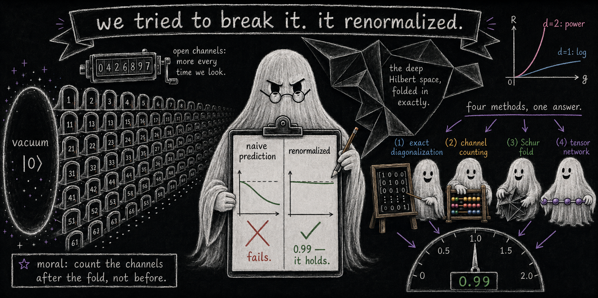

# The multiplicity horn survives renormalization

*exact quantum evolution of a ghost–normal field theory, the folded channel sum, and an accumulated-truncation floor*



<sub>*Banner image: prompt written by Claude (Anthropic), rendered by ChatGPT (OpenAI).*</sub>

**Paper 7 of the [Indivisible Ghosts program](https://github.com/embeddetech/ghosts-program).** Jonathan Torkelson (2026).

**[Read the paper (PDF)](renormalized-ghosts-paper.pdf)** · LaTeX source in [`paper/`](paper/)

> **Status: working draft.** This manuscript is under the program's release-gate audit and is still being revised. It has not been peer reviewed. Read it accordingly; corrections land here as they are made.

## Abstract

Two earlier papers of this program price the ghost-sector trilemma on a premise: that the quantum vacuum-decay rate of a coupled ghost sector scales with the number of open resonant channels—the *multiplicity horn*—so that the divergent field-theoretic rate is a channel-counting statement, not an artifact of perturbation theory. Against this stands the possibility that structural effects beyond perturbation theory—the position we test, framed as the Gross–Strumia–Teresi–Zirilli (GSTZ) metastability suggestion—could erode the channel sum. We put the premise to a falsification test in a genuinely quantum, multimode 1+1-dimensional two-field theory (normal $`\varphi`$ plus ghost $`\chi`$, contact coupling $`\lambda\varphi^2\chi^2`$, equal masses: maximal resonance, with the four-particle $`\varphi\varphi\chi\chi`$ shell exactly degenerate with the vacuum) by exact sparse-propagator evolution and a static-$`E_0`$ Feshbach/Schur folding of the full Hamiltonian onto the resonant shell. The pre-registered fork read: (a) any deficit of the exact rate against the bare channel sum is absorbed by standard renormalization (dressing) of the states entering the golden rule, or (b) a structural suppression survives folding. The data return (a), to the $`{\sim}1\%`$ level (with a documented downward drift of the static-$`E_0`$ fold): across couplings where the *naive* channel sum misses by up to $`31\%`$, and across mode numbers up to $`M=16`$ where the naive ratio slides to $`0.774`$, the folded (Schur) prediction tracks the exact evolution at $`0.988`$–$`1.000`$. By elimination—diagonal self-energies and vacuum-column vertex corrections each reproduce the naive ratio to the four digits resolved—the deficit is attributed to the shell–shell block: first-order splitting and coherent mixing of the degenerate shell, textbook degenerate-level renormalization, no new mechanism. A dimension ladder calibrated to the exact Hamiltonian to $`5.7\times10^{-16}`$ reproduces the program’s reduced-measure rungs in quantum dress: the exactly resonant $`d=1`$ shell saturates with cutoff, the $`d=1`$ golden-rule sum grows log-class, and the $`d=2`$ sum grows as a power (fitted exponent $`2.26`$ against the predicted $`\approx2`$; a short-lever cutoff sweep, a mechanism check rather than a scaling measurement). A matrix-product-state cross-check certifies the position-space theory against exact diagonalization at $`L=4`$ (to $`6\times10^{-6}`$), runs in production at $`L=16`$, and then meets an honest limit that we characterize rather than hide: the Trotter/truncation floor is non-monotonic in the step ($`0.337/0.057/0.231`$ at $`dt=0.04/0.02/0.01`$, $`D=40`$), and raising $`D`$ from $`40`$ to $`64`$ moves the floor from $`0.057`$ to $`0.062`$—saturation, per the pre-registered decision rule. The volume-scaling extension is therefore left open at the MPS level; the verdict itself rests on the exact methods. Conformal-gravity pricing that leans on the multiplicity premise survives this test; positions that require a nonperturbative erosion of the channel sum do not receive support at any scale we can reach.

## Reproducing the results

Each script is standalone Python (NumPy/SciPy) and prints its controls inline. The paper's *Code availability* section maps scripts to results.

```
pip install numpy scipy
python scripts/t5_campaign.py
```

| Script |
|---|
| [`t5_campaign.py`](scripts/t5_campaign.py) |
| [`t5_channel_ladder.py`](scripts/t5_channel_ladder.py) |
| [`t5_dimension_ladder.py`](scripts/t5_dimension_ladder.py) |
| [`t5_floor_diag.py`](scripts/t5_floor_diag.py) |
| [`t5_floor_mechanism.py`](scripts/t5_floor_mechanism.py) |
| [`t5_mps.py`](scripts/t5_mps.py) |
| [`t5_mps_gate.py`](scripts/t5_mps_gate.py) |
| [`t5_mps_prod.py`](scripts/t5_mps_prod.py) |
| [`t5_partial_folds.py`](scripts/t5_partial_folds.py) |
| [`t5_prod_dt01.py`](scripts/t5_prod_dt01.py) |
| [`t5_run_one.py`](scripts/t5_run_one.py) |
| [`t5_stage2.py`](scripts/t5_stage2.py) |
| [`t5_stage3.py`](scripts/t5_stage3.py) |
| [`t5_stage4.py`](scripts/t5_stage4.py) |

Archived outputs and run notes cited by the paper:

- [`diag_floor_c64_dt02.txt`](scripts/diag_floor_c64_dt02.txt)
- [`diag_floor_mechanism.txt`](scripts/diag_floor_mechanism.txt)
- [`diag_ghost_c64_dt02.txt`](scripts/diag_ghost_c64_dt02.txt)
- [`dt01_floor.txt`](scripts/dt01_floor.txt)
- [`dt01_floordt04.txt`](scripts/dt01_floordt04.txt)
- [`dt01_L32.txt`](scripts/dt01_L32.txt)
- [`dt01_lam003.txt`](scripts/dt01_lam003.txt)
- [`dt01_lam012.txt`](scripts/dt01_lam012.txt)
- [`dt01_twin.txt`](scripts/dt01_twin.txt)
- [`log_diag1.txt`](scripts/log_diag1.txt)
- [`log_diag2.txt`](scripts/log_diag2.txt)
- [`log_dt01_floor.txt`](scripts/log_dt01_floor.txt)
- [`log_dt01_lam003.txt`](scripts/log_dt01_lam003.txt)
- [`log_dt01_lam012.txt`](scripts/log_dt01_lam012.txt)
- [`log_dt01_twin.txt`](scripts/log_dt01_twin.txt)
- [`mps_gate_result.txt`](scripts/mps_gate_result.txt)
- [`mps_prod_results.txt`](scripts/mps_prod_results.txt)
- [`results_partial_folds_M8_cap6.txt`](scripts/results_partial_folds_M8_cap6.txt)
- [`results_val_M10_cap4.txt`](scripts/results_val_M10_cap4.txt)
- [`results_val_M12_cap4.txt`](scripts/results_val_M12_cap4.txt)
- [`results_val_M16_cap4.txt`](scripts/results_val_M16_cap4.txt)
- [`results_val_M6_cap6.txt`](scripts/results_val_M6_cap6.txt)
- [`SS5_NUMERICS.md`](scripts/SS5_NUMERICS.md)

## Audit trail and provenance

This manuscript is an experiment in AI-conducted research: the work was carried out by large language models (Claude, Anthropic), directed and reviewed by the author. The paper's provenance statement says who did what. Nothing here should be taken on trust.

- The audit process: [`AUDIT.md`](AUDIT.md)
- Pass-by-pass audit ledger: [`histories/paper7-history.md`](histories/paper7-history.md)
- The full research notebook, the originating conversation, and every companion paper: the [program hub](https://github.com/embeddetech/ghosts-program)

## License

MIT — see [`LICENSE`](LICENSE).
